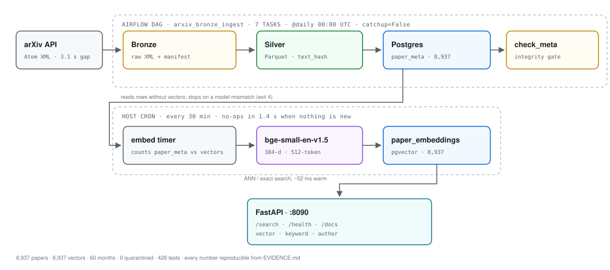

<div align="center">

<h1>DocPulse</h1>

<p><b>Paper search over arXiv that runs itself — and can show what it actually retrieves.</b><br/>
Harvest → silver → Postgres → embeddings → three retrieval modes, each one measured.</p>

<p>
  
  
  
  
  
  
  
</p>

<p>
  
  
  
  
  
  
</p>

<p>
  <a href="#quickstart">Quickstart</a> ·
  <a href="#architecture">Architecture</a> ·
  <a href="#retrieval-results">Results</a> ·
  <a href="#how-it-stays-correct">Incrementality</a> ·
  <a href="#known-limits">Limits</a> ·
  <a href="EVAL.md">Full eval</a> ·
  <a href="EVIDENCE.md">Evidence</a>
</p>

</div>

---

> **The claim, in three lines.**
> A paper arXiv announces tonight is searchable tomorrow, with no human in the loop.
> Only papers whose title or abstract actually changed are re-embedded — **99.4 % skipped** on a live pass.
> Exact-match and author retrieval are solved; semantic retrieval is **measured**, and weak on hard queries. [`EVAL.md`](EVAL.md) says exactly where.

**Not in scope, and not claimed:** there is no LLM and no RAG answer layer. Retrieval is the
substrate; generation is the next milestone. Nothing in this repo needs to be taken on trust —
every number below has a command behind it in [`EVIDENCE.md`](EVIDENCE.md).

## Architecture



| band | what it does | why it lives there |
|---|---|---|
| **Airflow DAG** | 7 tasks, `@daily` 00:00 UTC, `catchup=False`, ends at an integrity gate | ingest is long and network-bound; it belongs in something with retries and history |
| **Host cron** | every 30 min: compare counts, embed only what is missing | the Airflow image has no torch; the embedder image owns the model |
| **FastAPI** | `/search`, `/health`, `/docs` | `/health` probes Postgres *and* compares model fingerprints |

<!-- Optional: if you capture the Swagger page, save it as docs/img/swagger.png and uncomment:
<p align="center"></p>
-->

## Quickstart

```bash
dc up -d
```

```bash
curl -sS localhost:8090/health | jq '{ok, db, n_vectors, model_matches, query_prefix}'
```

Expect `ok: true`, `n_vectors: 8937`, `model_matches: true`. This endpoint probes the database
**and** compares the stored model fingerprint against the encoder's, returning **503 with a
reason** when either disagrees — the one check that notices a container that is `Up` on top of
a dead or stale database.

```bash
curl -sS 'localhost:8090/search?q=graph+neural+networks&mode=vector&limit=5' \
  | jq '.results[] | {arxiv_id, title}'
```

```bash
curl -sS 'localhost:8090/search?author=Yann+LeCun' | jq '{mode, n: .n_returned}'
```

Interactive docs at **`localhost:8090/docs`**, schema at `/openapi.json`.

> [!IMPORTANT]
> `mode` accepts only `vector` or `keyword`. Author mode is inferred from the presence of
> `author=`; sending `mode=author` returns **422**. Author search needs the **full** first-author
> name — partial names are the single biggest cause of empty results.

## Retrieval results

Two golden sets, both grounded in the corpus rather than written from memory. Full tables, the
misses, and the two instrument faults found on the way: [`EVAL.md`](EVAL.md).

**Queries whose words appear in the paper** — 180 queries:

| query kind | mode | recall@10 | MRR | mean latency |
|---|---|:---:|:---:|:---:|
| exact title | keyword | 1.000 | **1.000** | 4.5 ms |
| 8 consecutive words | keyword | 1.000 | 0.983 | 4.2 ms |
| exact title | vector | 1.000 | 0.969 | 35 ms |
| 8 consecutive words | vector | 0.617 | 0.455 | 35 ms |
| full author name | author | 1.000 | **0.913** | 3.3 ms |

**Queries that share meaning but not words** — 30 queries, same 10 papers in each tier:

| difficulty | example | keyword | vector |
|---|---|:---:|:---:|
| easy — title restated plainly | "detecting fake reviews with language models" | 0.600 / 0.420 | **0.900 / 0.783** |
| med — the core claim, no jargon | "a model that learns without labelled data" | **0.500 / 0.450** | 0.400 / 0.400 |
| hard — oblique, no shared words | "what makes a paper memorable" | **0.300 / 0.124** | 0.200 / 0.111 |

*(recall@10 / MRR)*

**Read plainly:** keyword owns literal queries, vector wins when a person describes what they
want, and **both fail on riddles**. Vector latency is ~52 ms warm and flat; keyword ranges from
4.5 ms on a title to 120–168 ms on a nine-word question, because Postgres widens the scan.

**Where the misses actually live**, measured at `limit=500` of 8,937:

| missed paper | under MiniLM | under bge | diagnosis |
|---|:---:|:---:|---|
| 2611.04805 | rank 83 | **rank 42** | retrievable but outranked — a **ranking** problem |
| 2611.05277 | absent | **absent** | never in the top 500 — a **representation** problem |

A reranker fixes the first class. Only chunking fixes the second, at a measured 40 minutes of
re-embedding per attempt. Building either before this measurement would have been guesswork.

## How it stays correct

The pipeline is not "scheduled"; it is **scheduled and gated**.

```
ensure_bucket → ingest_to_bronze → verify_bronze → build_silver → verify_silver
              → load_meta → check_meta
```

`check_meta` asserts four counts — null authors, empty author arrays, missing case-insensitive
author index, missing text-search column — and **fails the run** rather than publish a corpus
that cannot answer author queries.

**Incrementality, with independent evidence.** `text_hash` covers title and abstract only, so a
category or version bump costs nothing while an edited abstract costs one vector. A no-op rerun
proves a skip path exists; it does not prove it discriminates. This does:

| measurement | code path | value |
|---|---|:---:|
| `n_changed` | embedding planner | **65** |
| `n_text_changed_papers` | silver build | **65** |

Two counters, different code, same announcement, same answer — 4,206 of 8,274 papers correctly
skipped, exactly 65 re-embedded because the text had genuinely changed.

**Two guards, both learned from a real incident:**

- The cron embedder asks `/health` first and **exits 4** on a model mismatch. Row counts cannot
  see a model swap: during the MiniLM → bge change it reported "nothing new" with 8,937 stale
  vectors behind it.
- A 40-minute re-embed is a **decision**, not a cron job's business, so the build refuses unless
  `EMBED_ALLOW_MODEL_CHANGE=1` is passed deliberately.

## Known limits

1. **No RAG, no generation.** Retrieval only; nothing writes an answer.
2. **Semantic retrieval is weak on abstract-level and oblique queries** — 0.400 and 0.200 recall@10. Measured, published, and attributed to two known causes.
3. **Precision is unmeasured.** The golden sets expect one paper; whether the other nine results were any good is not evaluated.
4. **No CI.** 426 tests pass locally; nothing runs them on push, and the eval scripts are not yet under `pytest`.
5. **Quarantine has never fired on real data.** 0 of 13,000 entries were bad — the mechanism is proven by tests only.
6. **HNSW is opt-in** and its presence has never been confirmed by `EXPLAIN`, so published latency is exact-search latency.
7. **Accents are not folded:** `Herve Panetto` will not find `Hervé Panetto`. **Homonyms are unresolvable** — arXiv ships no author identifiers.
8. **No authentication.** Dev-grade: unauthenticated object store, default Airflow credentials, single node.

## Design decisions

<details>
<summary><b>Why each of these choices, and what it cost</b> — click to expand</summary>

<br/>

| decision | reason |
|---|---|
| Fingerprint entries, not page bytes | raw responses embed request time; only entries are a valid idempotency measure |
| 144-hour lookback, 3.1 s spacing | arXiv visibility lags submission by up to ~78 h; config rejects anything under 3.0 s |
| Newest version wins in silver | otherwise a revision leaves a stale author list — measured at 6 gained / 1 lost |
| Circuit breaker at 5 % bad records | fail the build and write nothing, rather than publish a partial corpus |
| `text_hash(title, abstract)` | the embedded text is the searchable text; metadata churn must not cost a vector |
| Model pinned by fingerprint | an unpinned upgrade is a silent change in every result |
| Gate inside the DAG | a corpus that cannot answer author queries must fail at load, not at query time |
| bge-small over MiniLM | MiniLM's 256-token window silently discarded ~33 % of every abstract; bge covers it at 512 tokens, same 384 dims |
| Query instruction on the query side only | bge is trained that way; documents must never receive it, so it is applied at one call site |
| Query prefix kept out of the fingerprint | it changes nothing in the table; including it would force a pointless full re-embed |
| No RRF / hybrid fusion | measured first: the modes win on different query types, which is more useful than averaging them |
| Reranker and chunking not built yet | each fixes a *different* measured failure; building either first would have been guessing |

</details>

## Operations

<details>
<summary><b>The things that broke, and the rule each one produced</b> — click to expand</summary>

<br/>

| symptom | rule |
|---|---|
| `paper_meta does not exist` while the API answered fine | the live database is **`docpulse_embed`**, not `docpulse` |
| Postgres down 11 h with the API container `Up`; two containers dead 37 h unnoticed | container status says nothing about the database — `restart: unless-stopped` on the four long-lived services, `/health` for the truth |
| A run frozen for two days | a **paused DAG does not schedule task instances either** — unpausing resumed at the exact task it stopped on |
| `docker cp` into `./src` failed | the mount is **read-only**; new files need `chcon -t container_file_t` |
| `SignatureDoesNotMatch` from a host shell | run S3-facing code through `dc run`; host credentials or clock, not the pipeline |
| a model quietly kept 256 tokens while config said 4,000 chars | **truncation is silent** — check `max_seq_length` on any model change |
| the repo could not rebuild its own vectors | the embedding operating point lives in `.env`, which is untracked — mirror it in `.env.example` |

**Never `dc down -v`, never `docker volume prune`.** The volumes are the corpus.

</details>

## Repository map

<details>
<summary><b>Where everything lives</b> — click to expand</summary>

<br/>

```
dags/                 the Airflow DAG
src/docpulse/         bronze, silver, embed, search packages
tests/                unit and DB-backed tests
contracts/            the YAML contract for silver
docker/               airflow and embed images
eval/                 golden question sets (JSON, corpus-derived)
docs/                 architecture diagram
scripts/              entry points, the embed timer, evaluation, one-off migrations
EVIDENCE.md           every claim, with the command behind it
EVAL.md               retrieval quality per query type, including the failures
PLAN_DAY9.md          costed plan for the two known retrieval fixes
docs/journal/README_DAY7.md        the Day-7 narrative: how the pipeline became unattended
```

</details>

## Tests

```bash
PYTHONPATH=src python3 -m pytest -q      # 426 passing
ruff check src scripts dags tests        # clean
```

DB-backed suites run against a scratch `docpulse_test` database, so they never touch the corpus.

---

<div align="center">
<sub>Built as a pipeline with a paper trail: <a href="EVIDENCE.md">EVIDENCE.md</a> · <a href="EVAL.md">EVAL.md</a> · numbers measured on 8,937 real arXiv papers</sub>
</div>
